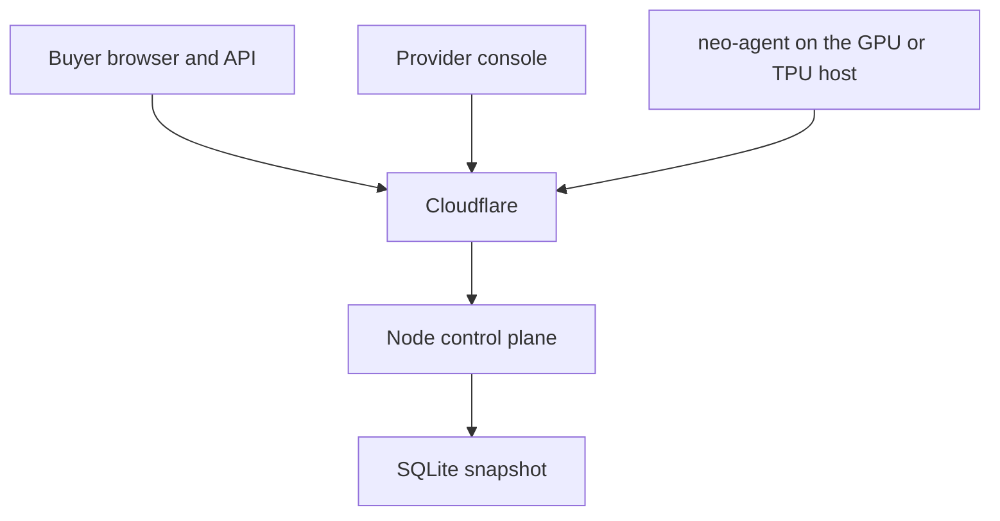
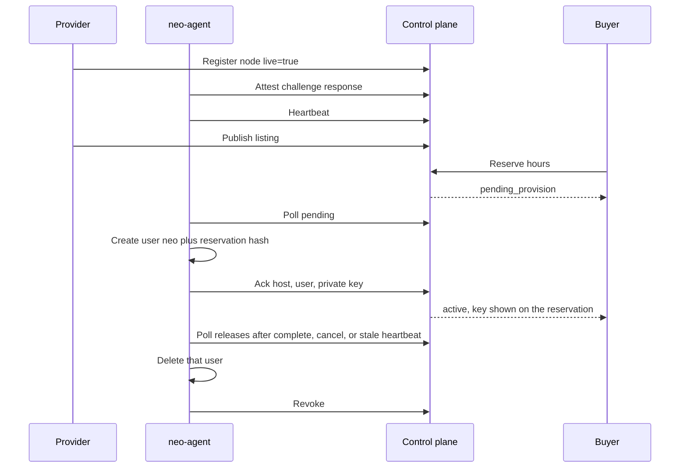
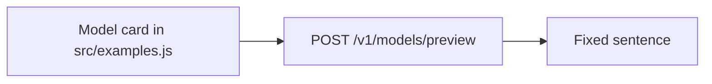

# Architecture, workflow, and model choices

**Date:** 8 November 2026 (Pacific)  
**Code:** repository `main` @ `1310d4d`  
**Longer design note:** [SYSTEM_DESIGN.md](../../SYSTEM_DESIGN.md) (the status line in that file is older than PR #17 and PR #20; this file matches the running control plane)

## System context

The control plane is `src/server.js` and the domain modules under `src/`. Static pages live in `public/` and are served from an allowlist, not from an open directory. The agent is `scripts/neo-agent.mjs`, version 0.2.0.

## Reservation workflow

States that matter:

| State | Meaning |
|---|---|
| `pending_provision` | Live reserve, waiting for the agent |
| `active` | Agent acked, or an example reserve stored a note |
| `completed` | Window ended on an active hold |
| `cancelled` | `provision_timeout`, `ended_before_provision`, `agent_offline`, or the buyer cancelled |

Example reserves skip the agent. `node_id` is null. `connection_info` is only `{ note: "Simulated reservation." }`.

## AI workflow that actually runs

Preview requires an API key and is rate limited. The reply is `This is a canned example from Neo Clouds.` No prompt is sent to Llama, Gemma, OpenAI, Anthropic, or any other model host. No token usage is recorded. No GPU is scheduled.

There is no prompt library, no tool-calling graph, no retrieval index, and no model router in this repository. Those were removed with the old chat surface on 25 Sep 2026.

## Model and provider choices

| Choice | What it is | What it is not |
|---|---|---|
| Llama 3.1 70B Instruct on the example H100 row | A catalog card with listed token rates | A call to Meta, Groq, Together, or a local vLLM |
| Llama 3.1 8B Instruct on the example A100 row | A catalog card | A served model |
| Gemma 2 9B Instruct on the example TPU v5e row | A catalog card | A call to Google AI or a TPU runtime |
| Listed GPU and TPU hourly rates | Discovery prices on the listing | An invoice or a contracted price |
| neo-agent on the provider's own host | The provider's machine, the provider's SSH | Neo Clouds-operated capacity |

The architect's model decision is to show the catalog shape buyers expect, and to refuse to pretend a preview executed a model. A later decision can attach a real runtime to a live reservation. That decision is NC-105 and it is open.

## Repository map

| Path | Role |
|---|---|
| `src/server.js` | HTTP allowlist and routes |
| `src/examples.js` | Example machines, model cards, preview reply |
| `src/listings.js` | Live listings merged with examples, live rows first |
| `src/reservations.js` | Reserve, cancel, complete |
| `src/lifecycle.js` | Window end, provision timeout, quiet agent |
| `src/agent.js` | Heartbeat, attest check, ack, release, revoke |
| `scripts/neo-agent.mjs` | Host user lifecycle |
| `src/auth.js` | `nck_` customer keys, `nkp_` provider keys, recover, rotate |
| `src/db.js` | SQLite snapshot |
| `src/admin.js` | Operator overview |
| `public/` | Site |

## Originality, stated narrowly

The novel piece is the binding of a marketplace reservation to a single host identity, a liveness proof, and a user that exists only for that reservation. The model cards are not an original model. The preview sentence is not an original prompt system.
